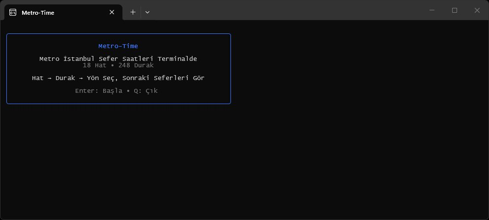
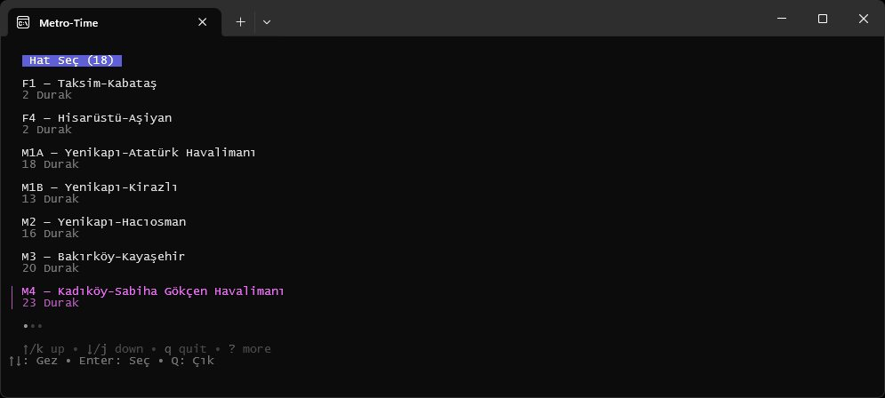
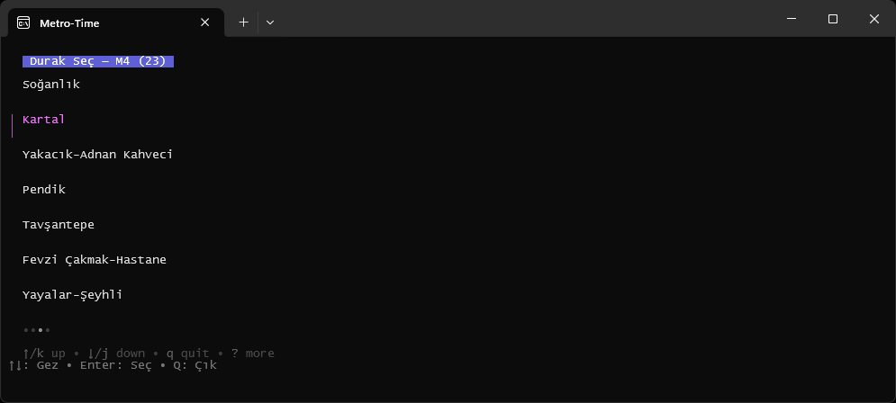
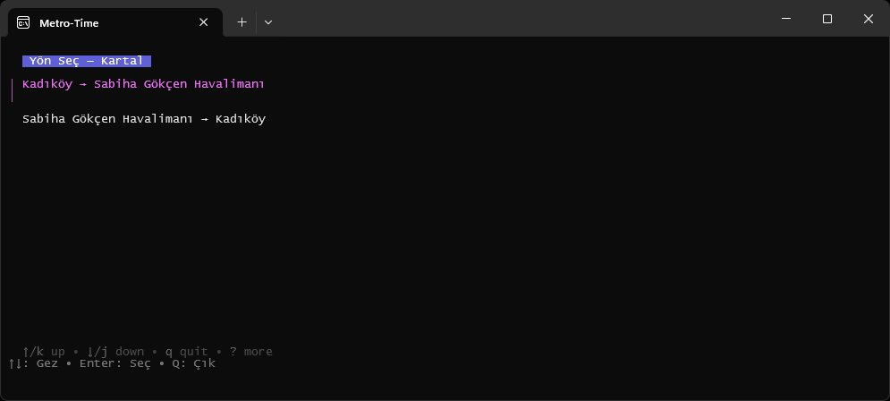
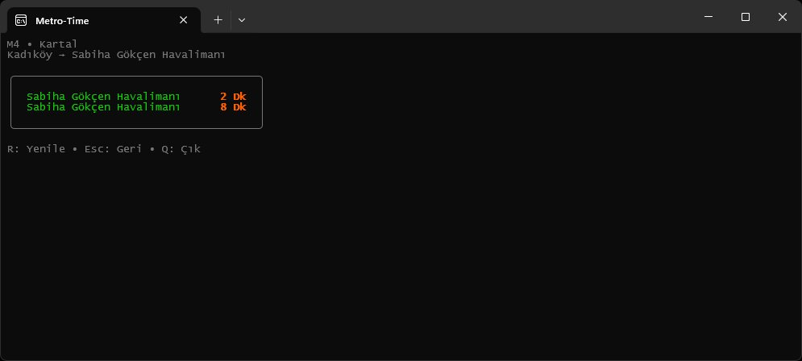

# Metro-Time

Metro İstanbul sefer saatleri terminalde. Hattını, durağını ve yönünü seç,
sonraki seferleri istasyondaki tabelaya benzeyen bir ekranda gör. Liste her
30 saniyede bir kendini yeniler.

## Go Kurulumu

Kaynaktan derlemek için Go 1.24+ gerekir.

| İşletim Sistemi | Komut |
|---|---|
| Windows | `winget install GoLang.Go` |
| macOS | `brew install go` |
| Linux | [go.dev/dl](https://go.dev/dl) adresinden `linux-amd64` arşivini indirip kur |

Linux'ta arşivle kurulum:

```bash
sudo rm -rf /usr/local/go
sudo tar -C /usr/local -xzf go1.27.linux-amd64.tar.gz
```

Kurulumu doğrula: `go version`

## Çalıştırma

Go kuruluysa (1.24+):

```bash
go run ./cmd/metro-time
```

Hazır çalıştırılabilir dosya:

```bash
.\metro-time.exe   # Windows
./metro-time       # Linux / macOS
```

## Kullanım

| Tuş   | İşlev                        |
|-------|------------------------------|
| ↑ ↓   | Listede gez                  |
| Enter | Seç / Başla                  |
| Esc   | Bir önceki ekrana dön        |
| R     | Seferleri hemen yenile       |
| Q     | Çık                          |

Akış: Karşılama → Hat Seç → Durak Seç → Yön Seç → Sonuç.







## Nasıl çalışıyor?

Metro İstanbul'un herkese açık bir API'si yok. Uygulama, resmi sitenin
sefer sayfasını açıp oturum bilgisini alır, sonra aynı sitenin veri
isteğini taklit ederek seferleri çeker. 18 hat ve 248 durak uygulamaya
gömülüdür (`internal/data/metro-hatlar.json`), internet sadece güncel
saatleri almak için gerekir.

## Veri Kaynağı

Sefer verileri Metro İstanbul'un resmi sitesinden (`metro.istanbul`)
alınır. Bu veriler İBB Açık Veri Portalı'nda "Metro İstanbul Sefer
Tarifeleri" adıyla, İstanbul Büyükşehir Belediyesi Açık Veri Lisansı
(CC BY 4.0 ile uyumlu) kapsamında yayınlanır; lisans kaynağın
belirtilmesini şart koşar. Lisans: `https://data.ibb.gov.tr/license`

## Not

Bireysel bilgilendirme amaçlı açık kaynak çalışmadır; Metro İstanbul A.Ş.
ile resmi bağı yoktur. Sefer verileri `metro.istanbul` adresinden alınır.
