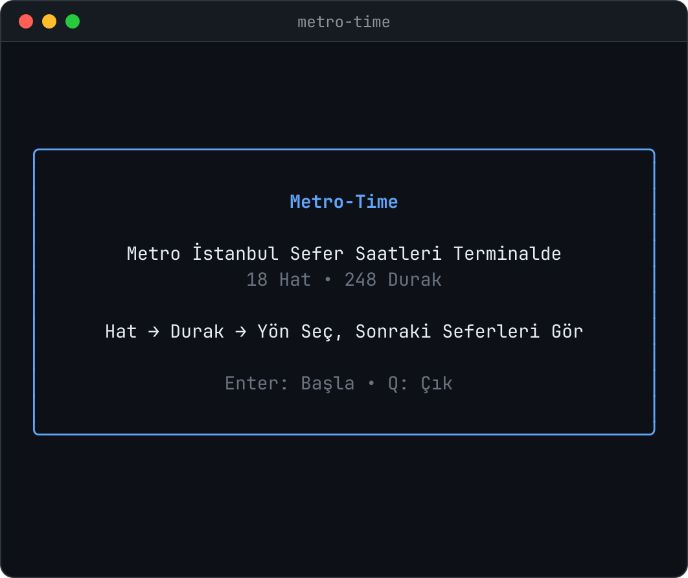
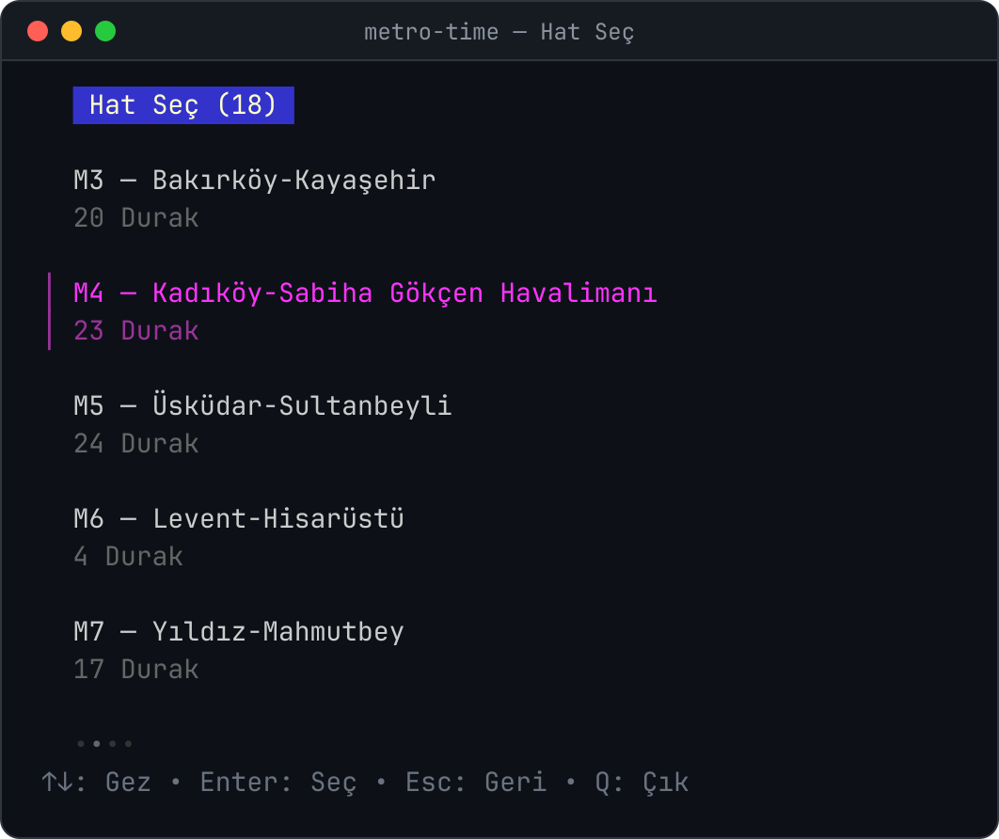
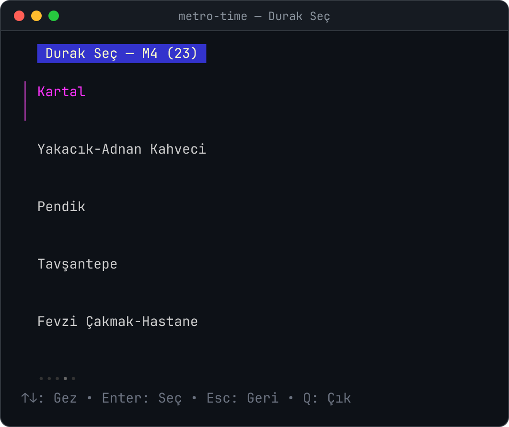
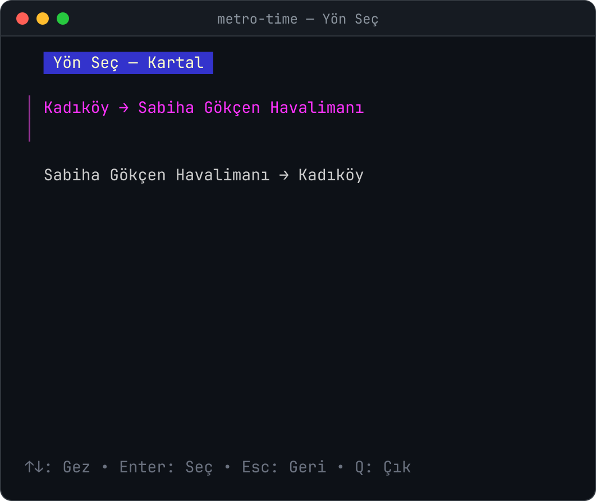
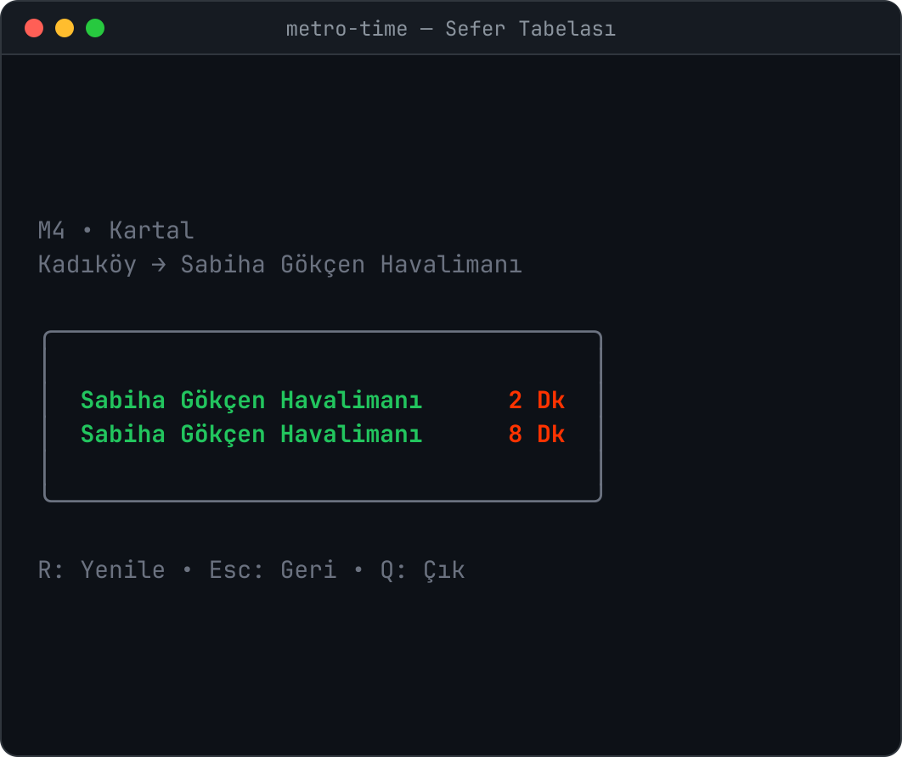

# Metro-Time

Metro İstanbul sefer saatlerini doğrudan terminalde gösteren TUI (Terminal UI) uygulaması. Hattını, durağını ve yönünü seç; sonraki seferleri istasyonlardaki LED tabelaya benzeyen bir ekranda takip et. Liste her 30 saniyede bir otomatik yenilenir.

- **Kapsam:** 18 hat ve 248 durak uygulama içine gömülüdür (`internal/data/metro-hatlar.json`); internet yalnızca güncel sefer saatlerini çekmek için kullanılır.
- **Akış:** Karşılama → Hat Seç → Durak Seç → Yön Seç → Sefer Tabelası

## Ekran Görüntüleri

<table>
  <tr>
    <td align="center" valign="top"><strong>1. Karşılama</strong><br></td>
    <td align="center" valign="top"><strong>2. Hat Seçimi</strong><br></td>
  </tr>
  <tr>
    <td align="center" valign="top"><strong>3. Durak Seçimi</strong><br></td>
    <td align="center" valign="top"><strong>4. Yön Seçimi</strong><br></td>
  </tr>
  <tr>
    <td colspan="2" align="center" valign="top"><strong>5. Sefer Tabelası</strong><br></td>
  </tr>
</table>

## Kullanım

| Tuş   | İşlev                        |
|-------|------------------------------|
| ↑ ↓   | Listede gez                  |
| Enter | Seç / Başla                  |
| Esc   | Bir önceki ekrana dön        |
| R     | Seferleri hemen yenile       |
| Q     | Çık                          |

## Kurulum ve Çalıştırma

Kaynaktan derlemek veya çalıştırmak için **Go 1.24+** gerekir.

| İşletim Sistemi | Kurulum Komutu |
|---|---|
| Windows | `winget install GoLang.Go` |
| macOS | `brew install go` |
| Linux | [go.dev/dl](https://go.dev/dl) adresinden `linux-amd64` arşivini indirip kur |

Linux'ta arşivle kurulum örneği:

```bash
sudo rm -rf /usr/local/go
sudo tar -C /usr/local -xzf go1.24.0.linux-amd64.tar.gz
```

Kurulumu doğruladıktan sonra (`go version`) projeyi çalıştırabilirsin:

```bash
go run ./cmd/metro-time
```

Hazır çalıştırılabilir dosya kullanıyorsan:

```bash
.\metro-time.exe   # Windows
./metro-time       # Linux / macOS
```

## Hakkında ve Nasıl Çalışıyor?

Metro İstanbul'un herkese açık bir REST API'si bulunmuyor. Uygulama, resmi sefer sorgulama sayfasını açarak oturum bilgisini ve dinamik doğrulama kodunu alır, ardından sitenin kendi veri isteğini taklit ederek güncel kalkış saatlerini çeker.

### Veri Kaynağı ve Lisans

Sefer verileri Metro İstanbul'un resmi sitesinden (`metro.istanbul`) alınır. Bu veriler İBB Açık Veri Portalı'nda "Metro İstanbul Sefer Tarifeleri" adıyla, İstanbul Büyükşehir Belediyesi Açık Veri Lisansı (CC BY 4.0 ile uyumlu) kapsamında yayınlanır; lisans kaynağın belirtilmesini şart koşar. Lisans: `https://data.ibb.gov.tr/license`

### Sorumluluk Notu

Bu proje bireysel bilgilendirme amaçlı açık kaynak bir çalışmadır; Metro İstanbul A.Ş. ile resmi bir bağı yoktur.
